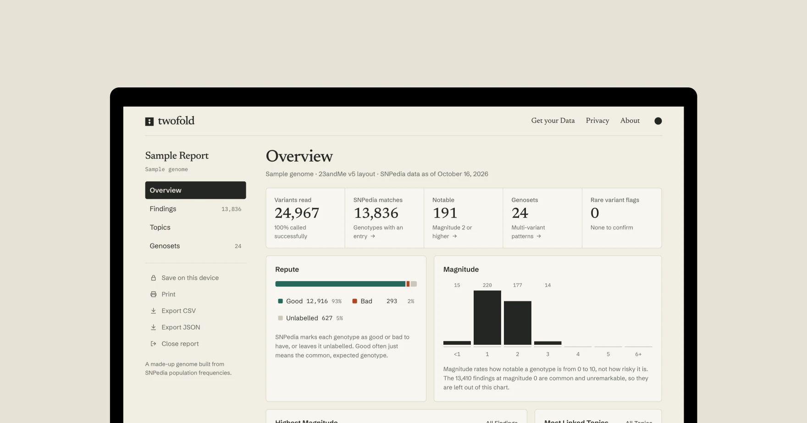

Twofold reads the raw data file from a consumer DNA test and explains what research says about it: susceptibility to health conditions, response to medicines, and traits from metabolism to personality. Every genotype in the file is matched against a complete, dated snapshot of SNPedia, and the entire analysis runs on the user's device. The file is never uploaded, there is no account, and the site works offline after its first visit. Twofold is free, open source, and available at [twofold.brandonsaldan.com](https://twofold.brandonsaldan.com).

## Project History

Twofold began in 2023 as GeneCodex, a Next.js application I built after losing access to a paid genetics report. GeneCodex parsed DNA files in the browser and matched them against hand-curated modules of SNPedia entries grouped by theme, such as appearance, medicine response, and personality. It proved that private, client-side genetic analysis was practical, but the curated modules covered only a small fraction of SNPedia, and the project went dormant.

In 2026 the project was rebuilt from the ground up under a new name. The curated modules were replaced by a full SNPedia scrape, the interface was redesigned as a report dashboard, and the privacy model was tightened so that nothing about a person's genotypes ever reaches a server. The logo is a square with a semicolon cut out of it, a nod to how genotypes are written, like (A;G).

## The SNPedia Snapshot

Twofold ships its own copy of SNPedia instead of querying it live. A fetch script enumerates every SNP, genotype, genoset, gene, condition, medicine, and on-chip category through SNPedia's MediaWiki API, then downloads page revisions in batches of 50, one request at a time with a pause between each. The October 2026 snapshot requested 220,056 titles across 4,402 batches and is cached locally so interrupted runs can resume and later refreshes download only pages that changed.

A build step parses the wiki templates into 111,734 SNP records, 104,732 genotype annotations, and 283 genosets, then compiles them into two fixed files: a 3.6 MB compressed core used for matching and a 4.7 MB compressed file of longer notes, population frequencies, and references. Every visitor downloads the same two files, so no request ever depends on someone's genotypes.

## Privacy Architecture

DNA files are parsed and matched in a Web Worker, so even very large files never block the interface. Twofold reads files from 23andMe, AncestryDNA, MyHeritage, FamilyTreeDNA, and Living DNA, along with VCF files from whole genome sequencing, as plain text, CSV, ZIP, or GZ. Calls are normalized against SNPedia's stabilized strand orientation, and ambiguous palindromic calls are left out rather than guessed.

The site is fully static. A strict Content Security Policy only allows connections to the site itself, all fonts are self-hosted, and there is no analytics, account, or server route. A service worker caches the app and reference data, and the privacy page walks through verifying offline behavior in the browser's developer tools. Reports live in memory by default. People who want to keep one can save an encrypted copy in IndexedDB, protected by a passphrase using PBKDF2 and AES-GCM, while the raw file itself is never stored.

## Product Experience

Before any report opens, an acknowledgement screen explains that entries come from a community-edited wiki, that consumer chips sometimes report variants that are not really there, and that findings should be discussed with a doctor or genetic counselor. Nothing in the report is hidden behind that screen.

The report is a dashboard. The overview summarizes matches, magnitude, repute, and the most linked topics. Findings can be searched and filtered by magnitude, repute, chromosome, and topic. Topic pages group findings by condition, medicine, gene, or collection, and genosets show patterns SNPedia defines across several variants at once, along with the criteria behind each match. Selecting any finding opens a detail panel with the full SNPedia entry, every possible genotype, population frequencies, and references. High-magnitude results on rare variants are flagged so they can be confirmed clinically.

Reports can be printed or saved as PDF with a magnitude cutoff, or exported as CSV and JSON. A sample report, built from a synthetic genome generated with SNPedia population frequencies, lets anyone explore the interface before using their own data.

## Technology Stack

Twofold is built with Astro, React, and TypeScript, with processing in a Web Worker and fflate for compressed files. The design uses Newsreader, Schibsted Grotesk, and IBM Plex Mono with a monochrome palette shared with this site. Vitest covers file parsing, genotype matching, and genoset evaluation, while Playwright tests confirm that the sample report and a realistic 23andMe file process offline without new network requests.

## Project Status

Twofold is under active development. It is free to use, open source on [GitHub](https://github.com/brandonsaldan/twofold), and live at [twofold.brandonsaldan.com](https://twofold.brandonsaldan.com).
